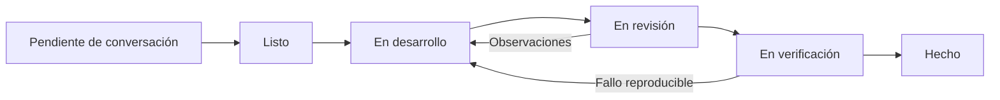

# Proceso de desarrollo propuesto y evidencia de aplicación

Fecha: **2026-11-12, America/Lima**. Proyecto académico para Paz Sur,
Ingeniería de Software I, UNSAAC. Docente: Jisbaj Gamarra Salas.
Equipo: Brenda Lucia Mayhuire Chacón, Adel Alejandro Merma Ccarhuarupay,
Franshesco y Daniela; los apellidos completos de estos dos últimos no se han
proporcionado y no se inventan.

## 1. Contexto

El sistema organiza capacitaciones de una empresa comercial en Cusco. El
registro manual de asistencia y su posible transcripción a Excel dificultan la
consulta ordenada. El producto debe mejorar planificación, participación y
seguimiento con evidencia verificable. No se dispone de entrevistas ni de las
presentaciones originales del docente: los temas citados proceden del encargo.

## 2. Restricciones e incertidumbres

- Cuatro estudiantes, tiempo académico limitado y capacidad no medida.
- Las 28 HU y las reglas detalladas son candidatas; Jira no fue consultado.
- Las guías locales antiguas describen código en otra carpeta. El punto de
  partida inspeccionado en este clon solo contenía README y documentación.
- No se han verificado cuentas, permisos o despliegues en Supabase/Render.
- Reglas de asistencia, certificados, sedes, estados y avisos requieren cliente.
- Una implementación por IA no demuestra revisión humana ni cierre académico.

## 3. Enfoque seleccionado

Proceso **iterativo, incremental y adaptativo**, con Scrum como marco de
coordinación propuesto. Cada Sprint dura dos semanas y debe producir un flujo
utilizable con interfaz, API y persistencia, sin dividir la entrega en una
semana exclusivamente visual y otra exclusivamente de base de datos.

La iteración permite revisar lo aprendido; el incremento añade comportamiento
observable; la adaptación cambia prioridades y reglas a partir de feedback
real. Se conserva un modelo completo candidato, pero solo se construye el
alcance que puede verificarse. No se presentan las cuatro versiones como
eventos ya ocurridos.

## 4. Por qué Scrum, Kanban y prácticas de XP

| Práctica | Problema que resuelve | Evidencia necesaria para afirmar su aplicación |
| --- | --- | --- |
| Objetivo y Sprint Backlog de Scrum | Evitar intentar terminar las 28 historias a la vez. | Objetivo acordado, alcance seleccionado y revisión real al cierre. |
| Review y retrospectiva | Validar valor y corregir la forma de trabajo. | Registro de asistentes, feedback y decisiones; no basta un documento propuesto. |
| Tablero y límites WIP de Kanban | Hacer visibles bloqueos y reducir cambios de contexto. | Tablero actualizado con fechas y estados de tareas reales. |
| Pruebas automáticas de XP | Evitar regresiones de validación, acceso e integridad. | Comandos y salidas reales sobre una base aislada. |
| Refactorización | Mejorar estructura sin alterar el contrato. | Problema observado, cambio real y pruebas antes/después. |
| Integración continua | Detectar incompatibilidades antes de integrar. | Workflow configurado y una ejecución remota real; una configuración sin ejecución no prueba CI aprobada. |

No se afirma que se practicó TDD: para ello tendría que existir evidencia de
una prueba fallida anterior a la implementación. Tampoco se simulan reuniones
Scrum ni programación en parejas entre estudiantes.

## 5. Responsabilidades propuestas

Las personas deben confirmar esta distribución. Describe responsabilidad de
revisión y coordinación, no autoría ya ejecutada.

| Persona/rol | Responsabilidad propuesta |
| --- | --- |
| Adel | Coordinar integración, entorno y contrato técnico; facilitar la comunicación del equipo. |
| Brenda | Apoyar refinamiento de requisitos y revisar planificación/interfaz de capacitaciones; revisar cambios de Adel. |
| Franshesco | Revisar inscripción, cupos e integridad de participantes. |
| Daniela | Revisar asistencia, historial y evidencia de pruebas. |
| Product Owner | Una persona delegada por el equipo debe ordenar el backlog con el cliente; nombre pendiente de acuerdo. |
| Scrum Master | Facilitador rotativo por Sprint, pendiente de acuerdo; no equivale a jefe del equipo. |
| Developers | Los cuatro estudiantes comparten responsabilidad de calidad y comprensión del incremento. |

La IA puede ayudar a implementar, analizar y revisar. No sustituye al cliente,
al revisor humano ni a los responsables académicos. La plataforma identifica
este agente como Codex basado en GPT-6; no expone una variante exacta.

## 6. Eventos y artefactos propuestos

- Planning al comienzo: 60–90 minutos para objetivo, capacidad y selección.
- Daily: hasta 15 minutos en días de trabajo para avanzar hacia el objetivo y
  señalar bloqueos; puede adaptarse al horario universitario con registro breve.
- Refinamiento: 30 minutos semanales para resolver conversaciones pendientes.
- Review: 45 minutos para ejecutar una demostración y recibir feedback.
- Retrospectiva: 30 minutos para elegir una mejora concreta del siguiente Sprint.

Artefactos: Product Backlog en `BACKLOG.md`, Sprint Backlog en `SPRINT_1.md`,
incremento ejecutable, criterios de aceptación, DoD y evidencia. Jira puede
reflejar estos elementos cuando se verifiquen claves y permisos; no fue
actualizado en esta sesión. Las duraciones son propuestas adaptables.

## 7. Flujo de trabajo

Una tarea está Lista cuando tiene historia, criterios comprobables,
dependencias disponibles, datos ficticios y alcance razonable. El bloqueo es
una marca adicional sobre el estado, con causa y fecha; no una columna que
oculte el trabajo iniciado.

1. Leer solicitud vigente, documentos, estado Git y código real.
2. Elegir una entrega vertical y escribir casos válidos, inválidos y límite.
3. Crear o usar rama de funcionalidad compatible con las ramas existentes.
4. Implementar presentación, ruta, servicio y persistencia sin ocultar reglas
   críticas en el cliente.
5. Ejecutar controles pertinentes, corregir fallos y actualizar documentos y
   LaTeX; registrar limitaciones del entorno.
6. Preparar un diff revisable; obtener revisión de otro integrante y ejecutar
   la demostración acordada.
7. Integrar únicamente con autorización aplicable y verificar el resultado.
   Marcar Hecho solo cuando se cumpla la DoD.

## 8. Política de bloqueos

Registrar causa, responsable de desbloqueo, dependencia, momento de inicio y
próxima acción concreta. Comunicar al equipo el mismo día; si dura más de un
día de trabajo, tratarlo en coordinación y reducir/reordenar el Sprint Backlog
sin cambiar silenciosamente el objetivo. No sustituir credenciales ausentes
por secretos incrustados ni aprobación pendiente por una aprobación ficticia.
Avanzar tareas independientes cuando sea posible. Una limitación de entorno
debe distinguirse de un defecto del producto.

## 9. Límites WIP propuestos

| Estado | Límite de equipo | Política |
| --- | ---: | --- |
| Listo | 6 | Mantener pocas tareas suficientemente refinadas. |
| En desarrollo | 2 | Una tarea activa por persona; colaborar antes de iniciar una tercera. |
| En revisión | 2 | Atender revisiones antes de abrir trabajo nuevo. |
| En verificación | 1 | Terminar la comprobación vertical y su evidencia. |

Los límites deben ajustarse tras observar flujo real; no prueban capacidad.
Los agentes técnicos pueden trabajar en archivos distintos bajo coordinación
de una entrega autorizada. Su revisión no se registra como revisión de un
estudiante. Las ramas de compañeros y sus cambios se conservan.

## 10. Definition of Done común

Una historia solo se considera **Hecha** cuando:

- Satisface todos sus criterios de aceptación acordados, con evidencia.
- Valida entradas y permisos también en servidor; protege datos e integridad.
- Funciona contra persistencia real y conserva datos al volver a consultar.
- Supera las pruebas pertinentes de casos válidos, inválidos y límites, sin
  errores conocidos que impidan el flujo principal.
- Tiene código comprensible y ha sido revisada por otro integrante humano,
  según el flujo acordado; se atienden sus observaciones.
- Está documentada en API, trazabilidad, decisiones cuando corresponda y
  capítulo/bitácora LaTeX.
- Está integrada en la rama acordada mediante una acción real autorizada y
  se ha comprobado la integración.
- No incorpora secretos ni datos personales reales y conserva evidencia
  verificable de lo ejecutado y de sus limitaciones.

La aceptación específica de HU-01 es, por ejemplo, rechazar correo duplicado;
la DoD aplica además pruebas, revisión y documentación a todas las historias.
Una entrega local con pruebas puede estar verificada técnicamente y continuar
pendiente de revisión/integración. No se equiparan ambos estados.

## 11. Métricas propuestas

| Métrica | Cómo obtenerla | Situación inicial |
| --- | --- | --- |
| Tiempo de ciclo | Días desde En desarrollo hasta Hecho por tarea. | Sin línea base; no inventar valores. |
| WIP y edad del trabajo | Contar tareas iniciadas no terminadas y tiempo abierto. | Registrar cuando exista tablero. |
| Tiempo bloqueado | Sumar intervalos con causa y desbloqueo documentados. | Pendiente de primeras tareas. |
| Cumplimiento del objetivo | Demostración del resultado del Sprint y feedback. | No hay Sprint cerrado acreditado. |
| Defectos y regresiones | Casos fallidos/reabiertos por incremento, con severidad. | Utilizar solo resultados reales. |
| Capacidad/velocidad | Puntos aceptados con la misma escala tras varios Sprints. | No disponible; no predecir con puntos propuestos. |

No usar número de líneas, commits o respuestas de IA como productividad de una
persona. No convertir métricas de equipo en ranking de estudiantes.

## 12. Uso y revisión de IA

Registrar qué tarea asistió, archivos, decisiones y verificaciones. El humano
debe poder explicar un flujo, una regla y una prueba; revisar especialmente
autorización, SQL, validaciones, privacidad y errores. No atribuir trabajo
asistido a programación manual exclusiva. No enviar a servicios externos datos
reales, credenciales o archivos privados sin autorización. No enviar mensajes
a compañeros ni modificar Jira/GitHub por inferir una responsabilidad del plan.

La IA informa limitaciones y consulta dudas necesarias de negocio sin detener
trabajo independiente ya autorizado. Si cambia la arquitectura o una regla,
actualiza decisiones y requisitos antes de afirmar conformidad.

## 13. Ejemplo real de tarea: HU-01, alta de usuario

Esta tarea forma parte del incremento que se construye en esta sesión; no es
un Sprint histórico reconstruido. Su estado de verificación debe contrastarse
con el registro de pruebas de la entrega.

| Paso | Aplicación concreta |
| --- | --- |
| Definición | Como administrador, registrar una identidad para permitir el acceso autorizado. CA-01-1 a CA-01-3 en `CRITERIOS_ACEPTACION.md`. |
| Conversación | Documento obligatorio y entrega de contraseña pendientes de validar; se utiliza el supuesto S-02 para V1. |
| Archivos de trabajo | `src/Users.tsx` contiene formulario/consulta y roles; `src/App.tsx` controla sesión/navegación; `server/routes/users.js` maneja HTTP; `server/services/user-service.js` aplica negocio; `server/migrations/001_initial.sql` garantiza unicidad. |
| Verificación diseñada | Alta válida, consulta posterior, correo duplicado normalizado, campos inválidos, rechazo sin permisos y ausencia de hash en respuestas. |
| Ejecución | `npm.cmd run check`:28 pruebas de API/persistencia aprobadas y build aprobado; `npm.cmd run test:ui`:4 pruebas Chrome aprobadas, incluida alta/edición/duplicado de usuario. Resultados y límites en `docs/PRUEBAS.md`. |
| Documentación | Tarjeta HU-01, criterios, trazabilidad y capítulo de implementación/pruebas en LaTeX. |
| Cierre | Revisión humana e integración siguen pendientes hasta que existan sus registros reales. |

## Estrategia Git y revisión de Pull Requests

La inspección inicial encontró `main` y las referencias remotas
`origin/AD-1-registro-usuarios`, `origin/BrendaPro` y
`origin/feature/brenda-mayhuire`. Se conservan. La entrega actual utiliza
`feature/v1-base-funcional`; no requiere inventar una rama develop.

Para cuatro personas se propone ramas breves por HU desde una base acordada,
por ejemplo `feature/hu06-inscripciones`. Antes de integrar trabajo de una rama
personal, revisar su contenido y base; el nombre no demuestra que la historia
esté implementada. Mantener `main` como base estable mediante PR y revisión.

Guía de PR, **no acciones ejecutadas**:

1. Revisar `git status --short --branch`, `git diff --stat` y `git diff`.
   Seleccionar archivos explícitos; comprobar que no hay secretos o bases.
2. Ejecutar controles pertinentes y documentar sus salidas reales.
3. Con autorización para las acciones Git necesarias, crear commits
   descriptivos: `feat(usuarios): valida registro y duplicados` o
   `test(capacitaciones): cubre intervalos invalidos`.
4. Cuando se autorice publicar la rama, abrir un PR a la base acordada con
   problema, comportamiento, HU, archivos relevantes, pruebas y limitaciones.
5. Solicitar revisión a otro integrante. Para cambios de Adel se propone
   Brenda; los demás revisores se acuerdan por módulo. No aprobar el propio PR.
6. El revisor lee el diff, ejecuta el flujo con datos ficticios, verifica un
   caso negativo y registra observaciones concretas. Resolverlas antes del merge.
7. Integrar solo cuando esté autorizado; registrar URL/hash reales y ejecutar
   una comprobación sobre la rama integrada. No crear tags hasta incremento
   probado y autorización expresa.

No se acredita aquí la creación de commits, PR, tags, revisiones o merges.
